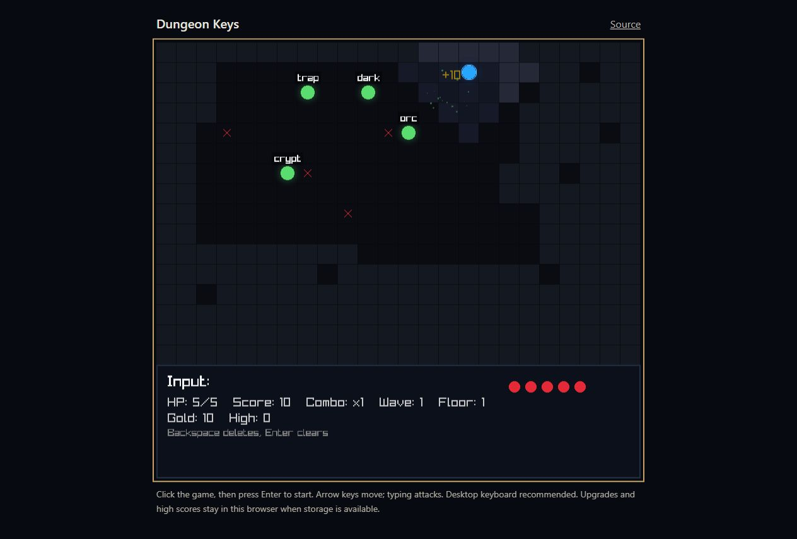

# Dungeon Keys

A typing roguelike built in C: move through a dungeon and type the words above enemies to defeat them.

[Play in the browser](https://bjnorwalk.github.io/dungeon_keys/)



A browser run after typing an enemy word: the score and gold increased to 10. Enemy words, health, wave, and floor are visible.

## The idea

Dungeon Keys combines keyboard movement with word-based attacks. Floors introduce waves, traps, and bosses; shops let players spend earned gold on upgrades between floors.

The engineering goal is to run the same gameplay code on desktop and in a browser, with platform-specific saving kept behind a small persistence module.

## Try it in one minute

Use a desktop keyboard.

1. Open the game, click inside it, and press Enter.
2. Move with the arrow keys or WASD.
3. Type the words displayed above enemies to attack them.
4. Between floors, use the shop to buy upgrades.

Browser upgrades and high scores use local storage when available. They are separate from desktop save files.

## Engineering work in this repository

The project implements the game loop, dungeon generation, enemies, combat, upgrades, word selection, and progress saving in C. raylib supplies the graphics and input APIs; Emscripten compiles the browser version.

Word-bank and save-state responsibilities have been extracted from the main file into modules with standalone regression tests. The caller owns save state rather than sharing gameplay globals with the persistence module.

## Architecture

```text
main.c: gameplay, entities, combat and rendering
  ├─ src/word_bank.c: loading and selecting enemy words
  ├─ src/save_data.c: progress serialization
  │    ├─ Desktop → save.dat
  │    └─ Browser → local storage
  └─ raylib: graphics and input

CMake → native executable
CMake + Emscripten → HTML / JavaScript / WebAssembly
```

## Key decisions and tradeoffs

- **Share gameplay across platforms.** One C implementation limits divergence between desktop and browser versions. Browser packaging, storage, and keyboard focus still need their own validation.
- **Keep persistence small and compatible.** The existing six-field save format and browser storage key are preserved. There is no account-based or cross-device synchronization.
- **Test logic without opening a window.** Persistence and word selection can be checked independently of raylib rendering. Those tests do not establish that combat pacing, keyboard handling, or the full game feels right.
- **Draw visuals in code.** The game avoids a separate art bundle, while keeping visual complexity within what the rendering code supports.

## Current limits

The browser game expects a desktop keyboard. Browsers that block local storage can still play, but progress lasts only for the current session. Desktop saves are local to the executable's working directory.

Automated checks cover persistence, word selection, and native/browser compilation. Gameplay, focus, controls, and real-browser save behavior need manual playtesting.

## Run locally

Use a C11 compiler and CMake 3.20 or newer. The first build downloads raylib 5.5,
so it needs a network connection and raylib's platform build dependencies.

```sh
cmake -S . -B build -DCMAKE_BUILD_TYPE=Release
cmake --build build --config Release
```

For a single-configuration build, run `build/typing_roguelike_polished`. With
Visual Studio on Windows, run `build/Release/typing_roguelike_polished.exe`;
with MinGW, run `build/typing_roguelike_polished.exe`. The executable keeps the
original CMake target name.

On macOS, install Xcode Command Line Tools (`xcode-select --install`) and CMake.
On Ubuntu, install the compiler, CMake, and raylib's development libraries:

```sh
sudo apt-get install build-essential cmake libasound2-dev libx11-dev libxrandr-dev libxi-dev libgl1-mesa-dev libglu1-mesa-dev libxcursor-dev libxinerama-dev
```

GitHub Actions runs a Linux build on pushes and pull requests.

## Build for the web

Install CMake and [Emscripten 6.0.11](https://emscripten.org/docs/getting_started/downloads.html),
then activate the SDK environment in your shell.

```sh
emcmake cmake -S . -B build-web -DPLATFORM=Web -DCMAKE_BUILD_TYPE=Release -DBUILD_EXAMPLES=OFF
cmake --build build-web --parallel 2
python3 -m http.server 8000 --directory build-web/web
```

Open `http://localhost:8000`. Serve the generated HTML, JavaScript, and WebAssembly
files together; opening the HTML directly from disk will not load the game.
GitHub Actions compiles this build and publishes it to GitHub Pages. Pull requests
build it without publishing. The merged browser port is available from `main`.

## Controls and saves

- Enter or Space starts a run.
- Arrow keys or WASD move; typing attacks the words displayed over enemies.
- Number keys select shop upgrades. Enter or Escape leaves the shop.
- Difficulty and other run controls are shown on screen.

The game writes `save.dat` in its working directory. An optional `wordlist.txt`
adds words; built-in lists are used when it is absent. Personal saves are ignored
by Git.

## Implementation

`main.c` contains the game loop, dungeon generation, entity state, combat, and drawing.
Word loading and save/load code live in `src/`. `CMakeLists.txt` downloads and links raylib. The visuals are
drawn in code, so the game does not need a separate art bundle.

Automated regression tests cover persistence and word selection. Build checks cover compilation;
gameplay, controls, and real-browser saving still need a manual run. Browser saves belong to the site origin
and are separate from desktop save files. Browsers that block local storage can
still play, but progress is limited to the current session.

## Source organization

`main.c` owns gameplay and rendering. `src/word_bank.c` owns word loading and
selection; difficulty is an explicit input. `src/save_data.c` owns the existing
`save.dat` format and the `dungeonKeys.save` browser storage bridge. The caller
owns `SaveData`; the module does not share gameplay globals.

Native CI runs standalone persistence and word-bank regression checks before
building raylib. Run their executable in a disposable directory because the
tests create `save.dat` and `wordlist.txt`. Browser compilation checks the same
modules under Emscripten.
